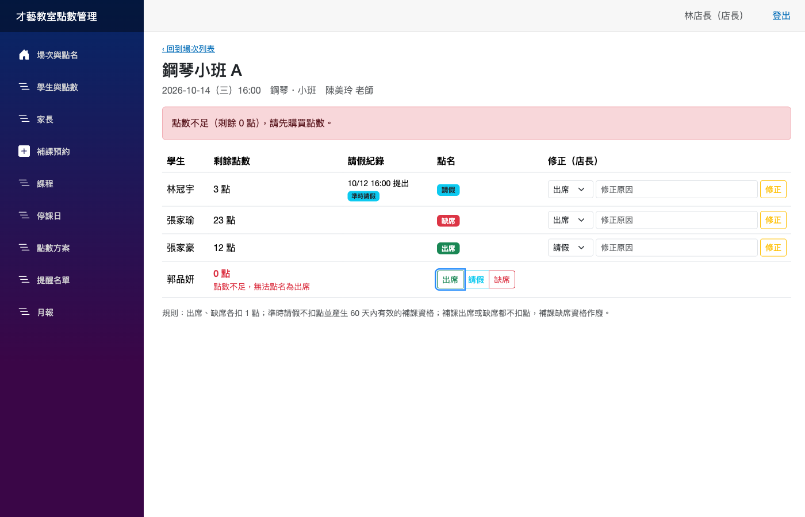
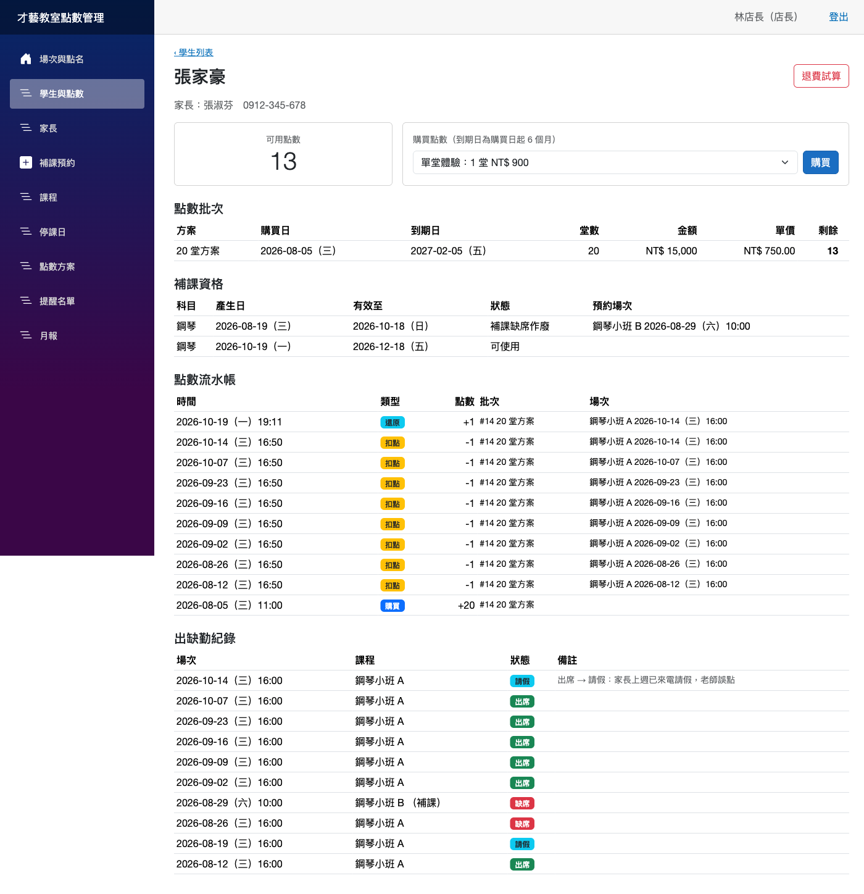
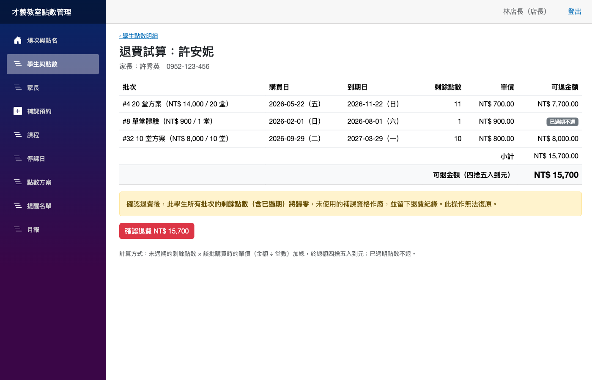
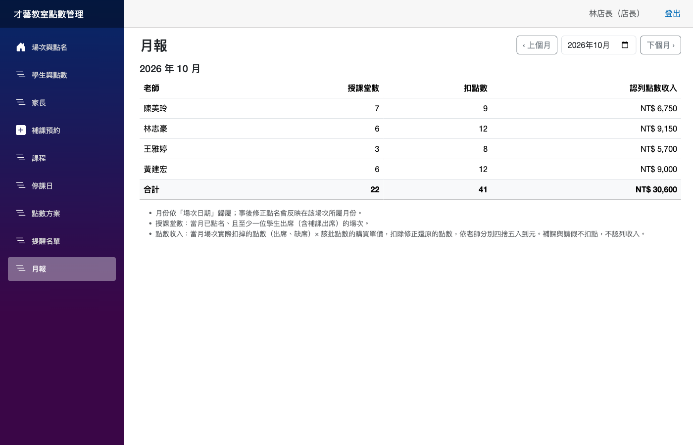
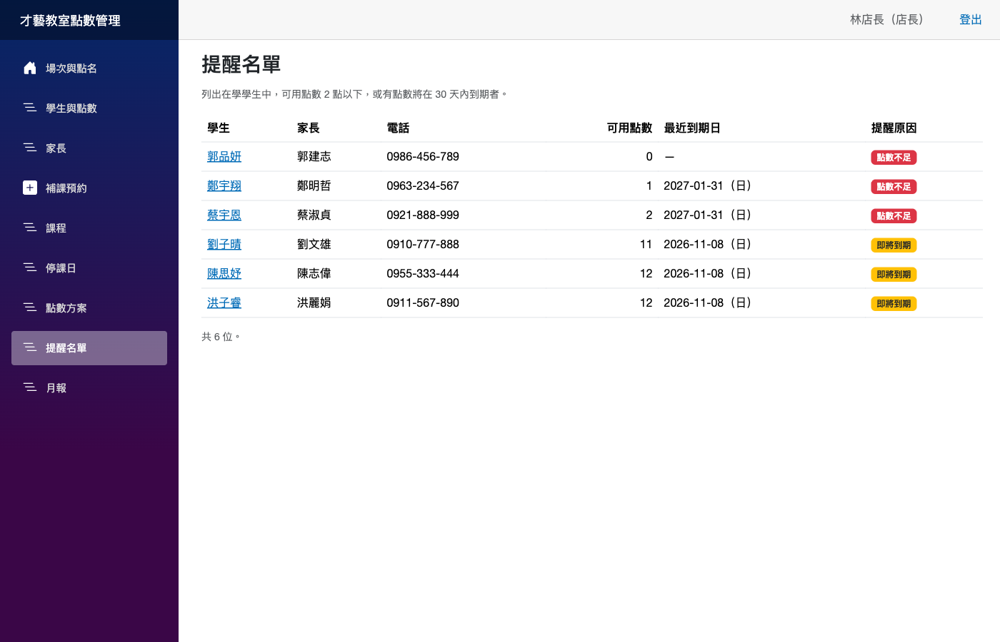
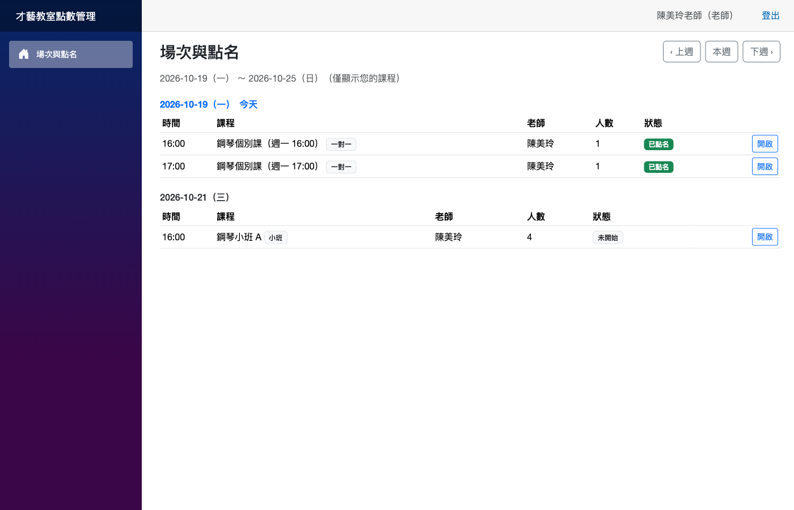

# Lesson Credits — 才藝教室上課點數與補課管理

[](https://github.com/hn83320589/Lesson-Credits/actions/workflows/ci.yml) [](LICENSE)

鋼琴與美術才藝教室的點數、點名、補課與退費管理系統。取代 Excel 與紙本點名卡，讓「明明請過假怎麼還扣點」、「點數什麼時候過期」、「中途不上要退多少」都能從系統紀錄直接回答。

- .NET 10、Blazor Web App（Interactive Server）
- EF Core + SQLite（附 migration）
- xUnit 單元測試 68 個（另附 [測試報告](docs/test-report.md)），GitHub Actions 於每次 push 自動建置與測試

## 啟動方式

需求：.NET 10 SDK。

```bash
dotnet run --project src/LessonCredits.Web
```

開啟 <http://localhost:5207>。首次啟動會自動：

1. 套用 migration 建立 `src/LessonCredits.Web/lessoncredits.db`
2. 載入範例資料（以啟動當天為基準，重演過去 10 週的營運紀錄）
3. 產生所有課程未來 8 週的場次（之後每次啟動都會補齊）

要重置資料，刪除 `lessoncredits.db` 後重新啟動即可。

執行測試：

```bash
dotnet test
```

## 範例帳號

| 角色 | 帳號 | 密碼 | 說明 |
|---|---|---|---|
| 店長 | `owner` | `owner123` | 所有功能 |
| 老師 | `chen` | `teacher123` | 陳美玲：鋼琴小班 A、鋼琴個別課 ×2 |
| 老師 | `lin` | `teacher123` | 林志豪：鋼琴小班 B、鋼琴個別課 ×2 |
| 老師 | `wang` | `teacher123` | 王雅婷：美術小班 A、美術個別課 |
| 老師 | `huang` | `teacher123` | 黃建宏：美術小班 B、C |

### 範例資料涵蓋的狀態

4 位老師、20 位家長、30 位學生（含兄弟姊妹）、10 門課（5 個小班、5 個一對一）。

| 想看的狀態 | 去哪裡看 |
|---|---|
| 多批不同單價的點數＋一批已過期 | 學生「許安妮」→ 退費試算 |
| 已完成退費 | 學生「吳志明」（已退費，剩餘 0 點，課程名單上無法點名出席）|
| 點數用完、無法點名出席 | 鋼琴小班 A 的「郭品妍」|
| 方案調價前購買（20 堂 14,000，單價 700）| 張家瑜、李宜庭、吳志明、許安妮、賴品睿 |
| 即將到期 / 點數不足 | 提醒名單 |
| 補課：可使用、已預約、已補課、補課缺席作廢、已逾期 | 補課預約頁、各學生點數明細 |
| 停課日 | 約 3 週前的週三「颱風停課」（已取消、無扣點）、約 3 週後的週六「國定假日」|
| 逾時請假視為缺席 | 點名頁的「逾時請假，視為缺席」標記 |

範例資料不是直接寫入資料表，而是用可調整的時鐘把購買、請假、點名、補課、退費**透過正式的服務層**重演一次，所以範例資料一定符合本文件描述的所有規則。

## 點數扣抵規則

| 項目 | 規則 |
|---|---|
| 購買 | 每次購買形成一批點數，記錄購買日、堂數、金額；**到期日 = 購買日 + 6 個月**（8/31 購買 → 2/28 到期）。到期日當天仍可使用。|
| 單價 | 該批金額 ÷ 堂數，於購買當下快照。方案日後調價不影響已購買的點數。|
| 歸屬 | 點數屬於學生個人，兄弟姊妹之間不可轉移。|
| 出席 | 扣 1 點 |
| 缺席 | 扣 1 點，不給補課資格 |
| 請假 | **上課前 24 小時（含）以前提出**：不扣點，產生 1 次補課資格。少於 24 小時：視為缺席，扣 1 點。|
| 扣點順序 | **先到期的批次先扣**（同到期日則先購買的先扣），減少家長的點數過期。|
| 判斷依據 | 有沒有可用點數以**場次日期**判斷；點數不足（含全部過期）時無法點名為出席或缺席，畫面顯示原因。|
| 補點名 | 老師事後才補點舊場次時，**可以從場次之後才購買的批次扣點**（只看到期日，不看購買日），讓家長事後購買點數補足欠的課；否則這堂課永遠無法點名，老師實際上了課卻沒有紀錄。例外：場次在退費之前，見「退費後帳務鎖定」。|
| 停課 | 店長標記停課日後，當天所有場次取消、不扣任何點數，已預約的補課退回。當天已有點名紀錄時不允許停課。|
| 點名時機 | 場次開始後才能點名；請假只能在開始前登記。|

### 請假時間如何判定

請假由店長（家長來電）或老師按「登記請假」，**請假時間由系統以當下時間蓋章，不能手動輸入**，避免倒填。點名時，有準時請假紀錄的學生才能點「請假」。

### 補課

- 補課資格自產生日起 **60 天**內有效（第 60 天可用、第 61 天不可用），預約當下與補課場次日期都必須在有效期內。
- 只能預約**同科目、小班、尚未開始、仍有空位**的場次；小班人數上限 4 人，計算方式為「固定學生 + 補課預約」。
- 一對一課程的請假同樣產生資格，但只能補在小班。
- 補課出席：不扣點，資格標記「已補課」。補課缺席：不扣點，資格作廢。
- 店長可在補課開始前取消預約，資格恢復可使用。

### 點名修正

只有店長可以修正，且必須填寫原因。系統的處理方式是**先撤銷舊狀態的效果，再套用新狀態的效果**：

| 修正 | 點數 | 補課資格 |
|---|---|---|
| 出席 → 請假 | 新增「還原」分錄，退回原本扣點的批次 | 產生（自修正日起 60 天）|
| 請假 → 出席 | 重新扣 1 點 | 作廢 |
| 出席 ↔ 缺席 | 不變 | 不變 |
| 缺席 → 請假 / 請假 → 缺席 | 同上兩列 | 同上兩列 |

若請假產生的補課資格已預約或已使用，不允許改回出席，需先取消補課預約。修正視為承認原紀錄有誤，因此改為「請假」不受 24 小時限制。

### 點數流水帳

所有點數異動（購買、扣點、還原、退費歸零）都寫成**只新增、不修改**的流水帳分錄，剩餘點數由流水帳加總而得。每一筆扣點都能追溯到哪一個場次、哪一批點數、單價多少，可直接回應家長的疑問。

## 退費計算方式

```
可退金額 = 四捨五入( Σ 未過期批次的剩餘點數 × 該批單價 )
```

- 已過期的點數不退。
- 小數只在**總額**四捨五入一次（MidpointRounding.AwayFromZero；.NET 預設是銀行家捨入，已明確指定）。
- 店長確認後：該學生**所有批次（含已過期）的剩餘點數歸零**、留下退費紀錄與逐批明細、未使用的補課資格作廢、學生標記為已退費（之後無法點名或請假；再次購買會恢復在學）。
- **退費後帳務鎖定**：退費金額是依確認當下的剩餘點數結清的，所以**場次開始時間早於退費**的點名紀錄不能再動到點數或補課資格：
  - **補點名**：退費前的場次一律不能補點名。即使學生退費後重新購買、恢復在學，也不能用新買的點數補扣退費前的課，或替退費前的請假產生補課資格。
  - **修正點名**：會改變點數或補課資格的修正（例如出席改請假會還原 1 點）一律拒絕；出席與缺席互改不影響點數，仍可修正。
  - 退費後重新購買、在退費之後才上的課，照常點名。

範例（單元測試 `Refund_matches_hand_calculation_with_two_prices_and_an_expired_batch`）：

| 批次 | 剩餘 | 單價 | 可退 |
|---|---:|---:|---:|
| 20 堂 15,000 | 5 | 750 | 3,750 |
| 10 堂 8,000 | 10 | 800 | 8,000 |
| 單堂 900（已過期）| 1 | 900 | 0 |
| **合計** | | | **11,750** |

## 收入認列方式（月報）

- **月份歸屬**：一律依**場次日期**。事後修正點名會反映在該場次所屬的月份。
- **點數收入**：當月場次實際扣掉的點數（出席、缺席）× 該批點數的單價，扣除修正還原的點數；依老師分別四捨五入到元，合計為各老師金額加總。請假與補課不扣點，不認列收入。
- **授課堂數**：當月已點名、且至少一位學生出席（含補課出席）的場次數。全員請假或缺席的場次，老師實際上沒有授課，不計入。

範例（單元測試 `Monthly_report_matches_hand_calculation`）：A 老師當月扣 3 點（單價 750）＋ 3 點（單價 800），其中 1 點修正還原 → 2,250 + 1,600 = 3,850；B 老師 1 次缺席（800）→ 收入 800、授課 0 堂。

## 權限規則

| 功能 | 店長 | 老師 |
|---|:-:|:-:|
| 場次列表、點名、登記請假 | ✅ 全部 | ✅ 僅自己的課程 |
| 修正點名 | ✅ | ❌ |
| 學生、家長、點數明細、購買 | ✅ | ❌ |
| 課程、選課、停課日、點數方案 | ✅ | ❌ |
| 補課預約 | ✅ | ❌ |
| 退費試算與確認 | ✅ | ❌ |
| 提醒名單、月報 | ✅ | ❌ |

權限在兩層檢查：

1. **路由層**：店長頁面標註 `[Authorize(Roles = "Owner")]`。未登入者直接輸入網址會被導向登入頁；老師帳號會被導向「無權限」頁。
2. **服務層**：每個服務方法都接收操作者（`Actor`），老師只能查詢與點名自己的場次。即使繞過畫面，例如直接開啟 `/sessions/{其他老師的場次}`，也只會顯示「您沒有權限存取其他老師的課程」。

### 驗證方式選擇：自建 Cookie 驗證

使用 ASP.NET Core Cookie Authentication，帳號存在自建的 `Users` 表，密碼用框架內建的 `PasswordHasher<T>` 雜湊（PBKDF2）。沒有採用 ASP.NET Core Identity 的理由：

- 只有店長與老師兩種角色、5 個帳號，家長不登入；Identity 會帶入 7 張資料表和大量 scaffold 頁面，大多用不到。
- 自建版本約 100 行，登入流程、Claims 內容（使用者、角色、老師編號）一目了然，容易說明與測試。
- 本案不需要註冊、忘記密碼、雙因素驗證、帳號鎖定。若日後需要，可再換成 Identity。

登入頁刻意採用**靜態 SSR**：Interactive Server 模式透過 SignalR 溝通，無法寫入 Cookie。

## 畫面截圖

### 點名（店長視角，含點數不足提示與修正）


### 學生點數明細（批次、補課資格、流水帳、出缺勤）


### 退費試算（兩種單價＋一批已過期）


### 月報


### 提醒名單


### 老師視角（只看得到自己的課程）


## 專案結構

```
LessonCredits.slnx
├── src/LessonCredits.Core/      類別庫（無 UI 相依）
│   ├── Domain/                  實體與列舉
│   ├── Rules/                   純函式業務規則：到期、扣點順序、請假時效、補課期限、退費、收入、提醒
│   ├── Services/                應用服務：購買、排課、點名、補課、退費、報表、基本資料
│   ├── Data/                    AppDbContext 與 Migrations
│   └── Time/TaipeiClock.cs      TimeProvider → 台灣時間
├── src/LessonCredits.Web/       Blazor Web App
│   ├── Auth/                    Cookie 驗證
│   ├── Components/Pages/        頁面
│   └── Seed/                    範例資料
├── tests/LessonCredits.Tests/   xUnit
│   ├── Rules/                   純規則測試
│   └── Services/                服務測試（SQLite in-memory + FakeTimeProvider）
└── docs/system-design.md        系統分析與架構設計
```

### 技術決策

- **時間**：所有「現在」都透過注入的 `TimeProvider` 取得，再由 `TaipeiClock` 轉成台灣時間；測試用 `FakeTimeProvider` 精準控制「上課前 24 小時 1 分」等邊界。
- **資料庫型別**：時間存台灣本地 `DateTime`，金額存整數。EF Core 的 SQLite provider 無法在 SQL 中比較 `DateTimeOffset`，也無法加總 `decimal`，所以單價改在記憶體中計算。
- **DbContext 生命週期**：Blazor Server 的 circuit 會長時間存活，所以服務使用 `IDbContextFactory`，每個操作建立一個短生命週期的 context。
- **併發控制**：點名、修正、退費、補課預約、停課、選課都是「先讀餘額或人數做判斷，再寫入」。這些操作在**第一次讀取前**就開始交易；Microsoft.Data.Sqlite 以 `BEGIN IMMEDIATE` 開始交易，會先取得寫入鎖，所以兩位老師同時幫同一位學生點名時，後到者會等前者 commit，再讀到最新餘額，不會扣成負數、多退款或超收補課。`ConcurrencyTests` 用第二條連線先佔住寫入鎖，確定性地重現這些競爭情況。
- **服務測試使用 SQLite in-memory**，不用 EF InMemory provider，因為後者不檢查外鍵與 unique 約束。

## 測試

`dotnet test` 共 68 個測試案例，對應驗收標準如下。完整的驗收結果（含端對端測試與資料一致性檢查）見 [docs/test-report.md](docs/test-report.md)。

| 驗收標準 | 測試 |
|---|---|
| 購買 10 堂 +10 點、到期日 +6 個月 | `Buying_ten_lesson_plan_adds_ten_credits_expiring_in_six_months`、`ExpiryDate_*` |
| 出席、缺席扣 1 點，請假不扣 | `Present_or_absent_deducts_one_credit`、`On_time_leave_does_not_deduct_and_grants_makeup_credit` |
| 24h01m 前請假準時、23h59m 前視為缺席 | `Leave_requested_24h01m_before_class_is_on_time`、`Leave_requested_23h59m_before_class_is_late`、`Late_leave_cannot_be_recorded_as_leave_and_absence_deducts` |
| 停課日場次取消、無扣點 | `Closure_day_cancels_all_sessions_that_day_and_no_credits_are_deducted` |
| 補課超過 60 天不可用、小班滿 4 人不可預約 | `Makeup_credit_older_than_60_days_cannot_be_used`、`Makeup_credit_is_valid_on_day_60_but_not_day_61`、`Cannot_book_makeup_into_a_full_group_class` |
| 出席 → 請假 → 出席：點數與資格同步 | `Correcting_present_to_leave_restores_credit_and_grants_makeup_then_back_to_present_reverses_both` |
| 點數用完無法出席並顯示原因 | `Cannot_mark_present_without_credits_and_reason_is_given`、`Expired_credits_cannot_be_used_and_reason_mentions_expiry` |
| 退費金額與手算一致 | `Refund_matches_hand_calculation_with_two_prices_and_an_expired_batch`、`Refund_quote_matches_hand_calculation` |
| 退費後餘額 0、無法出席 | `Confirmed_refund_zeroes_credits_and_blocks_further_attendance`、`RefundGuardTests`（退費後修正點名、退費後請假） |
| 併發：同時扣點、退費與點名同時進行、同時預約補課 | `ConcurrencyTests` |
| 提醒名單兩種條件 | `ReminderRulesTests`、`Reminder_list_covers_low_balance_and_expiring_soon` |
| 月報收入與手算一致 | `Revenue_matches_hand_calculation_including_a_restored_deduction`、`Monthly_report_matches_hand_calculation` |
| 老師權限 | `Teacher_cannot_take_attendance_for_another_teachers_session`、`Teacher_only_sees_own_courses_and_sessions`、`Teacher_cannot_confirm_refund` 等 |

## 假設與範圍外

- 教室位於台灣，所有時間以台灣時間（UTC+8）為準。
- 金額為新台幣整數；不串接金流，購買與退費只做紀錄。
- 家長沒有登入帳號，請假、補課預約、退費由店長代為操作。
- 一門課只有一位老師；老師請假、代課不在範圍內。
- 不支援修改課程時段後重新排場次；退費不會自動將學生退出課程名單。
- 資料量以 100 位學生、保存 3 年為上限，查詢未特別做分頁。

## 授權

[MIT](LICENSE)
