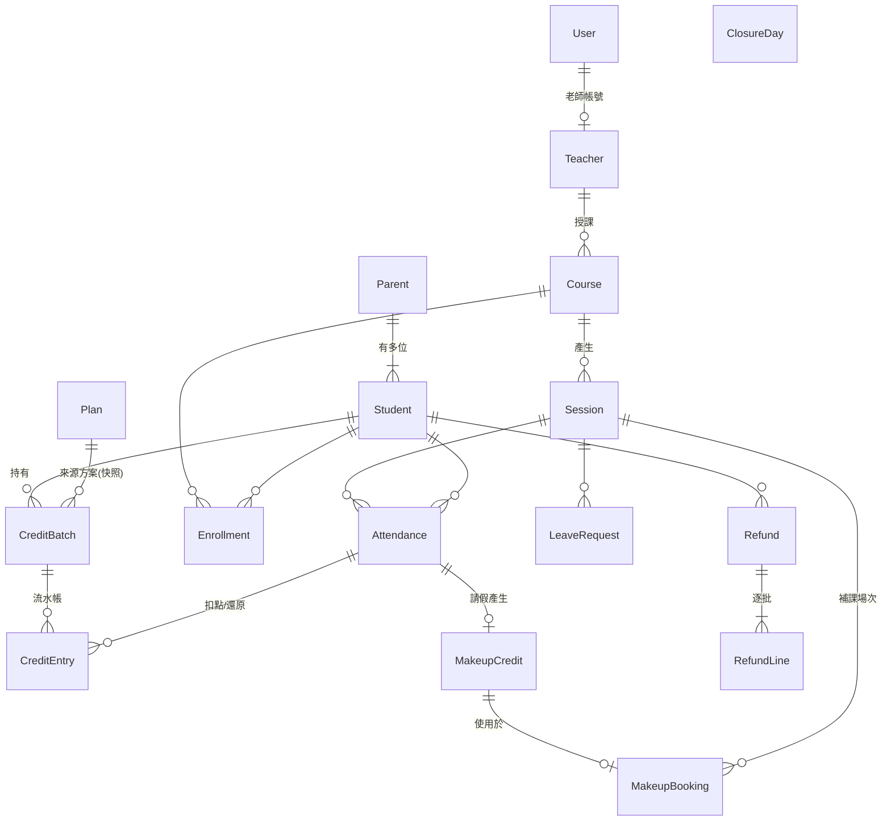

# Lesson Credits — 系統分析與架構設計

> 狀態：**已確認並實作**（D1～D5 皆採建議方案）
> 日期：2026-10-19

---

## 1. 問題本質

客戶的三大爭議都是「**事後無法還原當時發生什麼事**」：

| 爭議 | 根因 | 設計對策 |
|---|---|---|
| 明明請過假怎麼還扣點 | 請假時間沒有可信紀錄 | 請假由系統以 `TimeProvider` 蓋時間戳，不可手動填寫；點名頁顯示請假時間 |
| 點數什麼時候過期 | 多批點數混在一起算 | 每批點數獨立記錄到期日；學生明細逐批列出 |
| 中途不上要退多少 | 不同方案單價不同 | 點數異動採**流水帳（ledger）**，每筆扣點都知道來自哪一批、單價多少 |

因此整個系統的核心是一本**不可竄改的點數流水帳**：餘額不是一個被覆寫的欄位，而是流水帳加總的結果。修正錯誤時新增「反向分錄」，不刪除舊紀錄。

---

## 2. 角色與使用案例

| 使用案例 | 店長 | 老師 |
|---|:-:|:-:|
| 維護家長、學生 | ✅ | ❌ |
| 維護點數方案 | ✅ | ❌ |
| 購買點數（建立批次） | ✅ | ❌ |
| 維護課程、學生選課、產生場次 | ✅ | ❌ |
| 標記停課日 | ✅ | ❌ |
| 登記請假（家長來電） | ✅ | ✅（僅自己課程的學生）|
| 點名 | ✅ | ✅（僅自己的場次）|
| 修正點名 | ✅ | ❌ |
| 預約補課 | ✅ | ❌ |
| 退費試算 / 確認 | ✅ | ❌ |
| 學生點數明細 | ✅ | ❌ |
| 提醒名單 | ✅ | ❌ |
| 月報 | ✅ | ❌ |

家長沒有帳號，所有家長操作由店長代為執行。

---

## 3. 領域模型



### 3.1 主要實體

| 實體 | 關鍵欄位 | 說明 |
|---|---|---|
| `User` | UserName, PasswordHash, Role(Owner/Teacher), TeacherId? | 登入帳號 |
| `Teacher` | Name | |
| `Parent` | Name, Phone | 無登入 |
| `Student` | ParentId, Name, IsActive | |
| `Plan` | Name, Lessons, Price, IsActive | 改價不影響已購批次 |
| `CreditBatch` | StudentId, PlanName(快照), PurchasedOn, Lessons, Amount, ExpiresOn | **單價 = Amount / Lessons**（記憶體計算，不存）|
| `CreditEntry` | BatchId, Type, Quantity(±), AttendanceId?, RefundId?, OccurredAt | 流水帳，**只新增不修改** |
| `Course` | Name, Subject(鋼琴/美術), TeacherId, Type(一對一/小班), Capacity(1 或 4), DayOfWeek, StartTime, DurationMinutes | |
| `Enrollment` | CourseId, StudentId | 固定學生名單 |
| `Session` | CourseId, StartAt(台灣時間), Status(Scheduled/Cancelled) | Unique(CourseId, StartAt) 確保重複產生不會重複 |
| `ClosureDay` | Date, Reason | |
| `LeaveRequest` | SessionId, StudentId, RequestedAt, IsOnTime | 請假時間由系統蓋章 |
| `Attendance` | SessionId, StudentId, Status(出席/請假/缺席), IsMakeup, RecordedBy, RecordedAt, CorrectedBy?, CorrectedAt? | |
| `MakeupCredit` | StudentId, Subject, SourceAttendanceId, IssuedOn, ExpiresOn(+60天), Status | |
| `MakeupBooking` | MakeupCreditId, SessionId | |
| `Refund` / `RefundLine` | 申請時間、確認者、總金額 / 每批退點數 × 單價 | |

`CreditEntry.Type`：`Purchase(+n)`、`Deduct(-1)`、`Restore(+1)`、`Refund(-剩餘)`

### 3.2 狀態機

**補課資格 MakeupCredit**

```
Available ──預約──▶ Booked ──補課出席──▶ Used
    ▲                 │ └──補課缺席──▶ Forfeited
    └──取消預約/停課──┘
Available/Booked ──店長把來源點名改掉──▶ Voided
Available ──超過60天──▶ (查詢時視為 Expired，不另存狀態)
```

**點名修正：「先還原舊狀態的效果，再套用新狀態的效果」**

| 狀態 | 效果 |
|---|---|
| 出席 | 扣 1 點（Deduct）|
| 缺席 | 扣 1 點（Deduct）|
| 請假 | 不扣點 + 產生補課資格 |

例：出席 → 請假 = 還原 Deduct（新增 Restore 分錄回原批次）＋ 產生 MakeupCredit
例：請假 → 出席 = 作廢 MakeupCredit ＋ 重新 Deduct
例：出席 ↔ 缺席 = 點數不變

這個「還原 + 套用」的寫法讓 3×3 種修正組合不需要逐一寫 if-else。

---

## 4. 業務規則（可測試的精確定義）

### R1 點數批次與到期
- `ExpiresOn = PurchasedOn.AddMonths(6)`；**到期日當天仍可使用**，隔天起失效。
- 可用餘額（某日 d）= Σ 所有 `ExpiresOn >= d` 批次的流水帳加總。

### R2 扣點順序
- **先到期的先扣**（FEFO），同到期日則先購買的先扣。
  → 對家長最有利，減少點數過期浪費，也減少爭議。
- 判斷「有沒有點數」以**場次日期**為準，不是點名當下。
- 還原時回到**原本扣的那一批**（若那批已過期，就是過期了，不轉到別批）。

### R3 請假時效
- `IsOnTime = RequestedAt <= Session.StartAt - 24h`（剛好 24 小時算準時）
- 24 小時 1 分前請假 → 準時；23 小時 59 分前 → 逾時。
- 點名頁：有準時請假紀錄的學生預設為「請假」；逾時請假顯示提示並只能選出席/缺席。
- 老師不能對沒有準時請假紀錄的學生選「請假」（畫面顯示原因）。
- 店長修正點名時可直接改為「請假」（修正 = 承認原紀錄有誤，不受 24h 限制），需填修正原因。

### R4 點名
- 只能對 `Scheduled` 且已開始（`now >= StartAt`）的場次點名。
- 出席/缺席時可用餘額 < 1 → 拒絕，顯示「點數不足（剩餘 0 點 / 點數已於 yyyy-MM-dd 過期）」。
- 補課學生只有「出席 / 缺席」兩選項，都不扣點。

### R5 停課
- 標記停課日 → 當天所有 Scheduled 場次改為 Cancelled；之後產生場次時跳過停課日。
- 若當天已有點名紀錄 → 拒絕停課，要求先修正（避免默默改帳）。
- 該日的補課預約自動取消，補課資格回到 Available。

### R6 場次產生
- 範圍：今天起 8 週（56 天）內符合課程星期的日期。
- 冪等：已存在就跳過；觸發時機為「新增課程」與「應用程式啟動」，另有店長手動按鈕。

### R7 補課
- 資格有效期：`ExpiresOn = IssuedOn + 60 天`，**預約當下與補課場次日期都必須在有效期內**。
- 產生日：一般點名為請假時以**場次日期**起算；店長修正為請假時以**修正日**起算（店家延誤修正不讓家長吃虧）。
- 可預約場次：同科目、小班、Scheduled、尚未開始、`固定學生數 + 補課預約數 < 4`。
- 一對一的請假同樣產生資格，但只能補在小班。

### R8 退費
```
可退金額 = Round( Σ 未過期批次的剩餘點數 × (該批 Amount / Lessons) )
```
- 小數只在**最後總額四捨五入一次**（`MidpointRounding.AwayFromZero`；.NET 預設是銀行家捨入，必須明確指定）。
- 確認後：所有批次（含已過期）新增 `Refund` 分錄歸零、建立 Refund/RefundLine、作廢未使用的補課資格。

**手算範例（將寫成單元測試）** — 退費日 2026-10-19

| 批次 | 方案 | 購買日 | 到期日 | 剩餘 | 單價 | 可退 |
|---|---|---|---|---:|---:|---:|
| A | 20 堂 15,000 | 2026-06-01 | 2026-12-01 | 5 | 750 | 3,750 |
| B | 10 堂 8,000 | 2026-09-01 | 2027-03-01 | 10 | 800 | 8,000 |
| C | 單堂 900 | 2026-03-01 | 2026-09-01 | 1 | 900 | 0（已過期）|
| | | | | | **合計** | **11,750** |

小數範例：自訂方案 3 堂 1,000 元剩 2 點 → 666.67 → **667**。

### R9 提醒名單
符合任一條件（只列在學中的學生）：
- 可用餘額 ≤ 2
- 有剩餘點數 > 0 的批次，到期日落在 `[今天, 今天 + 30 天]`

畫面標示是哪個條件命中（可同時兩者）。

### R10 月報
- **授課堂數**：該月（依場次日期）已點名、且至少一位學生出席（含補課出席）的場次數，依老師分組。
- **點數收入**：該月**場次日期**的所有 Deduct − Restore 分錄 × 該批單價，依老師分組加總後四捨五入。

範例：10 月扣 3 點（750 批）+ 2 點（800 批），其中 1 點（800 批）被修正還原 → 2,250 + 1,600 − 800 = **3,050**。

---

## 5. 系統架構

### 5.1 方案結構

```
LessonCredits.slnx
├── src/
│   ├── LessonCredits.Core/          # 類別庫：沒有 UI 相依
│   │   ├── Domain/                  # 實體、列舉
│   │   ├── Rules/                   # 純函式規則：LeavePolicy, CreditAllocator,
│   │   │                            #   RefundCalculator, RevenueCalculator...
│   │   ├── Services/                # 應用服務：AttendanceService, PurchaseService,
│   │   │                            #   RefundService, MakeupService, ScheduleService, ReportService
│   │   ├── Data/                    # AppDbContext, EF 設定, Migrations
│   │   └── Time/                    # TaipeiClock（包裝 TimeProvider → 台灣時間）
│   └── LessonCredits.Web/           # Blazor Web App (Interactive Server)
│       ├── Components/Pages/        # 頁面
│       ├── Auth/                    # Cookie 驗證、登入端點
│       └── Seed/                    # 範例資料
└── tests/
    └── LessonCredits.Tests/         # xUnit
```

**分層原則**
- **規則（Rules）是純函式**：不碰資料庫、不讀時間，輸入→輸出。大部分驗收測試落在這層，快又穩定。
- **服務（Services）**：讀資料 → 呼叫規則 → 寫流水帳，一個交易內完成；所有授權檢查（老師只能操作自己場次）也在這層，不只靠 UI 隱藏。
- **不做 Repository pattern**：DbContext 本身就是 Unit of Work，再包一層只增加樣板。
- Blazor Server 的 circuit 會長時間存活，DbContext 不是 thread-safe，所以服務使用 `IDbContextFactory<AppDbContext>`，每個操作建立一個短生命週期的 context。

### 5.2 時間處理

- 所有「現在」來自 `TimeProvider`；測試用 `FakeTimeProvider` 精準控制（例如 24h±1 分鐘）。
- 時區固定 `Asia/Taipei`（UTC+8，無日光節約）。`TaipeiClock` 提供 `Now`（台灣 `DateTime`）與 `Today`（`DateOnly`）。
- 資料庫一律存**台灣本地時間的 `DateTime`** 與 `DateOnly`，不用 `DateTimeOffset`：EF Core 的 SQLite provider 無法在 SQL 中對 `DateTimeOffset` 做比較與排序。
- 金額存 `int`（新台幣整數），單價在記憶體以 `decimal` 計算：SQLite 沒有原生 decimal，EF 無法在 SQL 中對 decimal 做 SUM。

### 5.3 驗證與授權

- Cookie 驗證 + 自建 `Users` 表，密碼以框架內建的 `PasswordHasher<T>` 雜湊（理由見 §8 決策 D1）。
- 登入頁使用**靜態 SSR 表單**送出：Interactive Server 是透過 SignalR 溝通，無法在互動模式下寫入 Cookie。
- 授權：`[Authorize(Roles = "Owner")]` 套用在店長頁面；`AuthorizeRouteView` 的 `NotAuthorized` 顯示「無權限」頁；未登入導向 `/login`。
- 資料範圍：老師相關查詢在服務層一律加上 `TeacherId == 目前使用者`，直接打網址 `/sessions/{別人的場次}` 也會被拒。

### 5.4 啟動流程

`dotnet run` → `Database.Migrate()` → 若無資料則 Seed → 補產生未來 8 週場次 → 啟動網站。
資料庫檔案：`src/LessonCredits.Web/lessoncredits.db`（.gitignore 排除）。

---

## 6. 畫面清單

| 路徑 | 頁面 | 權限 |
|---|---|---|
| `/login` | 登入 | 匿名 |
| `/` | 今日 / 本週場次 | 全部（老師只看自己）|
| `/sessions/{id}` | 點名、登記請假 | 店長 / 該課老師 |
| `/students` | 學生列表（含剩餘點數） | 店長 |
| `/students/{id}` | **學生點數明細**：批次、流水帳、補課資格、出缺勤 | 店長 |
| `/students/{id}/purchase` | 購買點數 | 店長 |
| `/students/{id}/refund` | **退費試算** / 確認 | 店長 |
| `/parents` | 家長與學生維護 | 店長 |
| `/plans` | 方案維護 | 店長 |
| `/courses`、`/courses/{id}` | 課程、學生名單、產生場次 | 店長 |
| `/closures` | 停課日 | 店長 |
| `/makeup` | 預約補課 | 店長 |
| `/reports/reminders` | 提醒名單 | 店長 |
| `/reports/monthly` | **月報** | 店長 |

UI 使用 Blazor 範本內建的 Bootstrap，不額外引入元件庫。

---

## 7. 測試規劃（目標 ≥ 30 個）

| # | 層級 | 測試 | 對應驗收 |
|---|---|---|---|
| 1 | Rule | 10 堂方案購買後到期日 = 購買日 + 6 個月 | 購買 |
| 2 | Service | 購買 10 堂後剩餘點數 +10 | 購買 |
| 3 | Rule | 月底購買（8/31）到期日 = 2/28 | 邊界 |
| 4–6 | Service | 出席扣 1、缺席扣 1、請假不扣 | 扣點 |
| 7 | Rule | 24h 1m 前請假 → 準時 | 請假 |
| 8 | Rule | 23h 59m 前請假 → 逾時 | 請假 |
| 9 | Rule | 剛好 24h → 準時 | 邊界 |
| 10 | Service | 逾時請假無法點名為請假 | 請假 |
| 11 | Rule | FEFO：先扣先到期的批次 | 扣點 |
| 12 | Rule | 過期批次不可扣 | 扣點 |
| 13 | Service | 點數用完無法點名出席，回傳原因 | 點數不足 |
| 14 | Service | 停課日場次全部取消且無扣點紀錄 | 停課 |
| 15 | Service | 重複產生場次不會重複 | 場次 |
| 16 | Rule | 補課資格第 60 天可用、第 61 天不可用 | 補課 |
| 17 | Service | 小班已滿 4 人無法預約補課 | 補課 |
| 18 | Service | 不同科目不能補 / 一對一場次不能補 | 補課 |
| 19 | Service | 補課出席不扣點、資格 Used | 補課 |
| 20 | Service | 補課缺席資格作廢、不扣點 | 補課 |
| 21 | Service | 出席→請假：點數還原、資格產生 | 修正 |
| 22 | Service | 請假→出席：重新扣點、資格作廢 | 修正 |
| 23 | Service | 已被使用的補課資格，來源點名不可改回出席 | 修正 |
| 24 | Rule | 退費手算範例（三批，含過期）= 11,750 | 退費 |
| 25 | Rule | 退費小數四捨五入（666.67 → 667）| 退費 |
| 26 | Service | 退費確認後餘額 0、無法點名出席 | 退費 |
| 27 | Rule | 提醒名單：餘額 ≤ 2 | 提醒 |
| 28 | Rule | 提醒名單：30 天內到期（含第 30 天、不含第 31 天）| 提醒 |
| 29 | Rule | 月報收入手算範例 = 3,050 | 月報 |
| 30 | Service | 月報授課堂數依老師分組 | 月報 |
| 31 | Service | 老師無法對他人場次點名 | 權限 |

Service 層測試使用 **SQLite in-memory**（不用 EF InMemory provider，因為它不檢查外鍵與 unique 約束）。

---

## 8. 待決策事項

### 🔶 需要你決定

| # | 議題 | 建議 | 替代方案 | 取捨 |
|---|---|---|---|---|
| D1 | 驗證方式 | **自建 Cookie 驗證** + 框架內建 `PasswordHasher` | ASP.NET Core Identity | 只有 2 種角色、5 個帳號，Identity 會帶入 7 張表與大量 scaffold 頁面；自建約 100 行、容易說明與測試。缺點是沒有忘記密碼、鎖定等功能（本案不需要）|
| D2 | 請假流程 | **先「登記請假」（系統蓋時間戳），點名時依此判定** | 老師點名時手動輸入請假時間 | 手動輸入可以倒填時間，正是客戶的爭議來源 |
| D3 | 月報收入的月份歸屬 | **依場次日期**；事後修正會改變過去月份的數字 | 依分錄發生日期（已出的月報不變，修正反映在修正當月）| 依場次日期與「授課堂數」口徑一致、直觀；依發生日期較符合會計「已結帳不回溯」|
| D4 | 授課堂數定義 | **已點名且至少一人出席的場次** | 所有未取消的場次 / 已點名的場次（全員請假也算）| 全員請假時老師實際沒上課 |
| D5 | 缺席但點數不足 | **同出席一樣拒絕**，提示先購買 | 記錄缺席但不扣點、標記欠點 | 拒絕最簡單一致；欠點機制要多一套追討流程 |

### ✅ 我已採用的預設（有意見再提）

- .NET 10（本機 SDK 10.0.402，符合 ≥ 9 且為 LTS），方案檔用 `.slnx`
- 到期日當天仍可使用；扣點 FEFO；還原回原批次
- 補課名額 = 固定學生 + 補課預約（請假學生不釋出名額）
- 退費後作廢未使用補課資格；不自動退選課程
- 補課資格可由店長取消預約並回到 Available；補課場次本身不能再請假
- 不支援課程時段修改後重排場次（範圍外）

### 📦 將引入的套件

| 套件 | 用途 |
|---|---|
| `Microsoft.EntityFrameworkCore.Sqlite` / `.Design` | ORM、migration |
| `xunit`、`Microsoft.NET.Test.Sdk`、`xunit.runner.visualstudio` | 測試 |
| `Microsoft.Extensions.TimeProvider.Testing` | `FakeTimeProvider` |
| bUnit | **不使用**（選配，時間留給業務規則測試）|

---

## 9. 開發里程碑

每個里程碑結束時皆可編譯、測試全過，並各自 commit。

| # | 內容 | 預估 |
|---|---|---:|
| M0 | 方案骨架、git init、.gitignore、空的測試專案 | 1h |
| M1 | 領域實體、DbContext、初始 migration、純規則 + 測試（TDD）| 5h |
| M2 | Cookie 驗證、版面、權限、Seed 範例資料 | 4h |
| M3 | 家長/學生/方案/購買、學生點數明細頁 | 3h |
| M4 | 課程、選課、場次產生、停課日 | 3h |
| M5 | 請假、點名、點名修正 | 4h |
| M6 | 補課預約與補課點名 | 3h |
| M7 | 退費試算與確認 | 2h |
| M8 | 提醒名單、月報 | 2h |
| M9 | README、畫面截圖、最後驗收走查 | 3h |
| | **合計** | **≈ 30h** |
